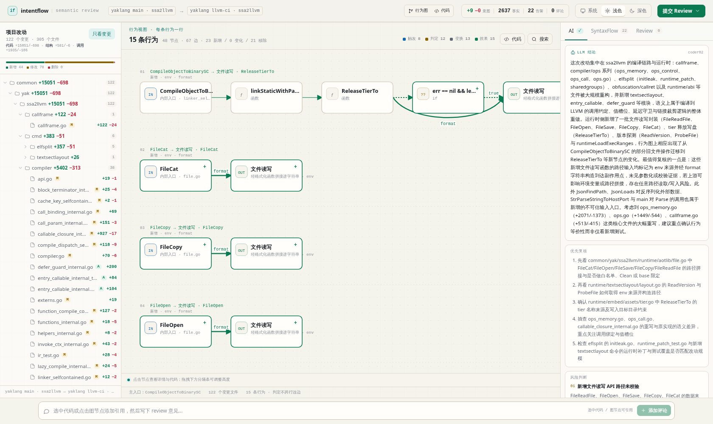
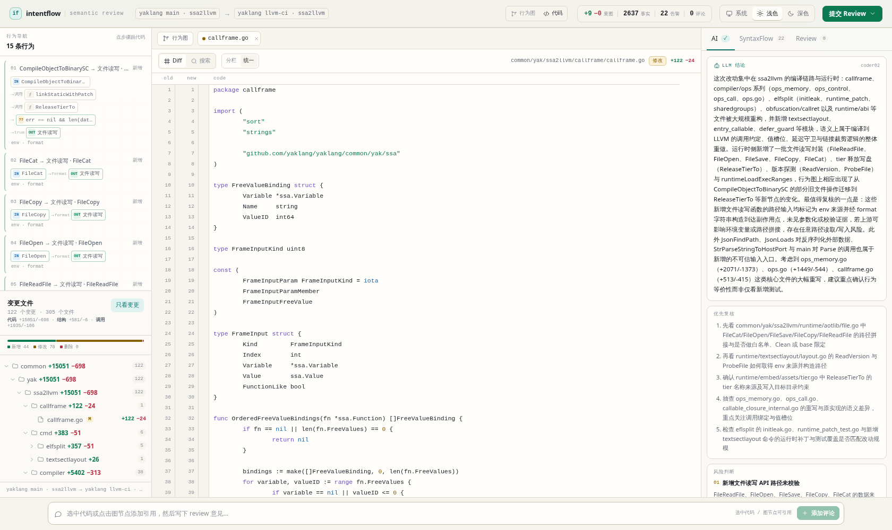

# intentflow

**一次改动，三个层面的语义 diff，加一张行为图。**

不是「哪些行变了」，是「这次改动在语义上干了什么」。

```
意图层   数据从哪来 ──▶ 经过谁 ──▶ 到达什么副作用      需要 SSA
逻辑层   谁调用了谁、在哪个条件里                       SSA
项目层   文件、函数与调用边的增删                        SSA

行为图   触发 ──▶ 判定 ──▶ 变换 ──▶ 效果               三层事实的场景投影
```

## 为什么

代码里没有「意图」。意图在人的脑子里。所以：

- **IR 算得出**的：数据流、调用边、依赖、条件。这些可复现。
- **IR 算不出**的：为什么这么改、合不合理。这些只能推断。

intentflow 把这两件事分层，**并给每条结论标可信度**。

行为图不是 LLM 画的。节点和边全部来自 SSA + SyntaxFlow；LLM 只读这些事实写摘要，不生成事实。

## 状态

**实验性。** 只支持 Go，目前有 demo-go 与 yaklang 分支两个样本。

已完成：三层 diff、SSA 意图链、行为图（触发/判定/变换/效果）、
独立 React + TypeScript 工作台（图视角 / 代码视角、底部代码坞、
行为侧栏、项目改动目录树、SyntaxFlow 分诊、Review 评论、提交给 Agent）、
OpenAPI 单一定义 + Go/TS 生成类型、可选 LLM 叙述层。

未完成：跨语言、整仓编译、完整路径敏感分析。

## 快速开始

```bash
# 1. 前端只需要构建一次
cd frontend && pnpm install && pnpm build && cd ..

# 2. 构建 CLI
go build -o bin/intentflow ./cmd/intentflow

# 3. 分析后直接打开工作台（默认 127.0.0.1:8123）
./bin/intentflow serve \
  --before examples/demo-go/before \
  --after  examples/demo-go/after \
  --out    examples/demo-go/out
```

输出：

```
examples/demo-go/out/
├── review.json         三层 diff、行为图、关注点
└── review.md           在工作台里提交后写入
```

只要结构化结果、不启动服务：

```bash
./bin/intentflow diff --before ... --after ... --out ...
```

前端开发时另开一个终端：

```bash
cd frontend && pnpm dev
# http://127.0.0.1:5173   /api 代理到 8123
```

加 `-v` 看进度，`--dump-facts` 导出两侧全量事实。
`--addr` 改监听地址，`--dist` 改前端产物目录，`--before-label` / `--after-label`
改页面顶部显示的标签。项目层、逻辑层、意图层都从同一次 SSA 编译读出，
没有 `--no-ssa` 的降级路径。

## demo 的输出

`examples/demo-go` 的改动：

1. `findUser` 从参数化查询改成 `fmt.Sprintf` 拼接，并按输入是否含 `@` 选择 SQL 模板。
2. `handleSearch` 新增 `name == ""` 守卫。
3. 新增 `loadTemplate`，从环境变量拼路径读模板。

```go
// before
db.QueryRow("SELECT id FROM users WHERE name = ?", name)

// after
switch {
case strings.Contains(name, "@"):
    query = fmt.Sprintf("SELECT id FROM users WHERE email LIKE '%%%s%%'", name)
default:
    query = fmt.Sprintf("SELECT id FROM users WHERE name LIKE '%%%s%%'", name)
}
rows, err := db.Query(query)
```

intentflow 报出来的：

```
意图层 ±2/1  逻辑层 ±7/2  项目层 ±1/0  关注点 5

ADDED    findUser：数据流入 SQL 执行
         shape=format  source=http_input      [DERIVED, HIGH]

ADDED    loadTemplate：数据流入 文件读写
         shape=concat  source=env             [DERIVED, warn]

REMOVED  findUser：数据流入 SQL 执行
         shape=direct  source=http_input      [DERIVED, info]

行为图   7 节点 · 12 边 · 2 条行为
         01 handleSearch → SQL 执行
            IN → 判定 name == "" → findUser → 判定 switch → SQL
         02 handleSearch → 文件读写
            IN → 判定 name == "" → loadTemplate → 文件读写
```

「新增了一条拼接的 HTTP→SQL 链路，同时移除了原来的参数化链路」——
这句话不是 LLM 猜的，是两边 IR 做差做出来的。

## 大项目：yaklang 分支

`examples/yaklang-llvm/` 是真实分支切片：

```text
before = yaklang@main
after  = feature/ssa2llvm/support_ci_and_mustpass_test
scope  = common/yak/ssa2llvm（304 个文件，122 个改动）
```

```bash
./bin/intentflow serve \
  --before examples/yaklang-llvm/before \
  --after  examples/yaklang-llvm/after \
  --out    examples/yaklang-llvm/out \
  --addr   127.0.0.1:8124 \
  --before-label 'yaklang main · ssa2llvm' \
  --after-label  'yaklang llvm-ci · ssa2llvm'
```

这次分析的规模：项目层 +581/−6，逻辑层 +1935/−106，意图层 +9，关注点 22，
行为图 15 条 scenario、48 节点、67 边（23 新增 / 21 移除 / 0 变化）。SSA 编译约 1 分钟。重新导出源码用
`examples/yaklang-llvm/generate.sh`。



代码视角：左侧行为导航，下面是变更文件树；没有悬浮缩略图。



## 工作台

- **行为图视角**：每条 scenario 一行，行内按步骤排；点击节点在底部代码坞看详情与源码，拖拽分隔条可调高度。
- **代码视角**：全宽 diff / 搜索；左侧是行为导航（每条 scenario 一条流程），下面是项目改动目录树。
- 右侧：SyntaxFlow 结果逐条分诊（认为没事 / 认为有问题），Review 评论可编辑删除。
- 底部：评论输入框。选中代码或在代码坞里点「引用到评论」会加入引用；点击节点只打开详情。
- 右上：提交 Review → 写入 `review.md`，同时复制 Agent prompt。

设计见 [docs/05-frontend.md](docs/05-frontend.md)。

## 契约

`schema/openapi.yaml` 是唯一 JSON 定义。Go 与 TypeScript 都由它生成：

```bash
make schema     # internal/contract/types.gen.go + frontend/src/api/schema.gen.ts
make check      # go vet + pnpm typecheck
```

`internal/model` 只保留领域别名、`FactSet`、`Identity`、`Diff`；JSON 结构体来自生成代码。
详见 [docs/08-contract.md](docs/08-contract.md)。

## 目录

```
cmd/intentflow/       CLI 入口（diff / serve）
schema/openapi.yaml   唯一数据契约
internal/contract/    生成：Go JSON 类型
internal/model/       三层数据模型 + 可信度 + 身份键
internal/scan/        SSA 索引、三层事实、signals、行为图
internal/emit/        review.json、facts.json
internal/insight/     可选 LLM 叙述层
internal/payload/     源码包：before/after 文本与文件状态
internal/serve/       HTTP 工作台：/api/payload、/api/review、静态资源
frontend/             React + TypeScript + Vite 工作台
examples/demo-go/     before/after 演示
examples/yaklang-llvm yaklang 分支切片（真实大项目）
docs/                 调研、模型、契约与日志
```

## 文档

| 文件 | 内容 |
| --- | --- |
| [docs/00-thesis.md](docs/00-thesis.md) | 论题：代码不能表达意图 |
| [docs/01-landscape.md](docs/01-landscape.md) | 六个相关项目盘点与分野 |
| [docs/02-layers.md](docs/02-layers.md) | 三层模型、身份键设计、抽取流程 |
| [docs/03-findings.md](docs/03-findings.md) | SyntaxFlow 实测行为与 Go 前端缺口 |
| [docs/04-compare.md](docs/04-compare.md) | 同一 demo 的四工具对比 |
| [docs/05-frontend.md](docs/05-frontend.md) | 两种视角：底部代码坞 / 行为侧栏 |
| [docs/06-behavior-research.md](docs/06-behavior-research.md) | PDG/CPG/Flows 调研，为什么不是入口/处理链/副作用 |
| [docs/07-behavior-model.md](docs/07-behavior-model.md) | 行为视图定义、身份键、阶段、diff 规则 |
| [docs/08-contract.md](docs/08-contract.md) | OpenAPI 单一定义、Go/TS 生成、兼容规则 |
| [docs/log.md](docs/log.md) | 实验日志 |

## AI 在哪里

当前版本：**不在图里，也不在 diff 里。**

- 节点/边来自 SSA + SyntaxFlow。
- `confidence` 只有 `EXTRACTED` / `DERIVED`。
- 没有 `INFERRED` 节点。

LLM 是可选叙述层：读事实写摘要、风险和复核顺序。它不生成节点、边或行号。
每个论点都要求引用输入里的证据；没有配置端点时界面显示“未启用”。

## 依赖

- `github.com/yaklang/yaklang v1.4.9-beta4`（SSA 编译器 + SyntaxFlow）。
- Go 1.24+。
- Node 22+、pnpm、Vite 7、React 19。
- `oapi-codegen v2.4.1`（`make tools` 安装）。

二进制约 265 MB，因为把整个 yaklang 链进来了。后续可以拆成独立进程。
