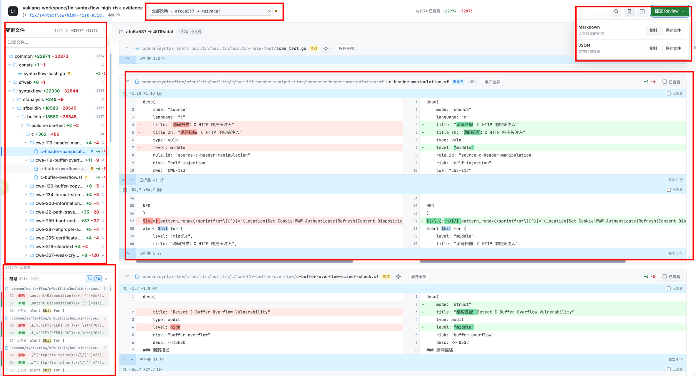
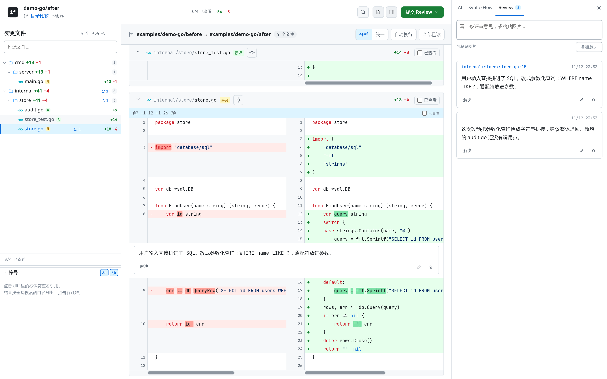
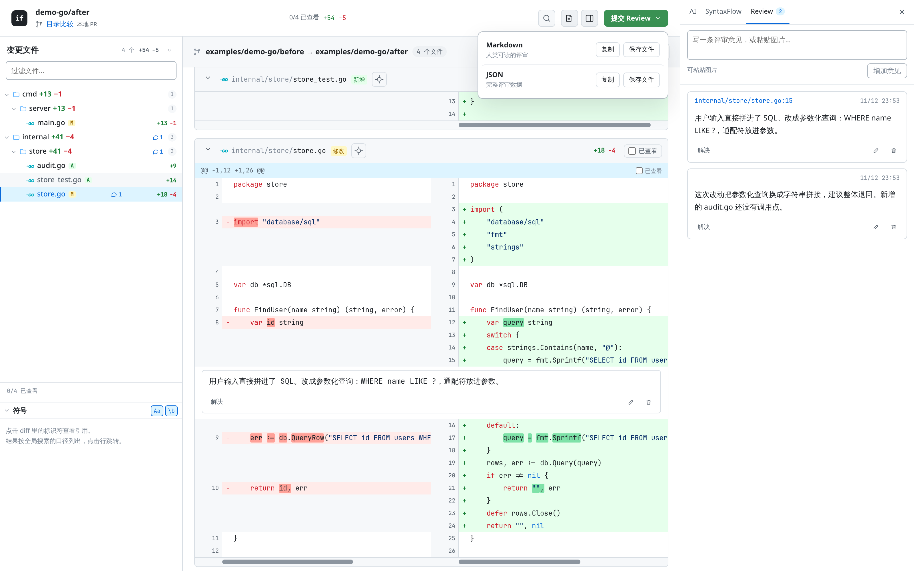
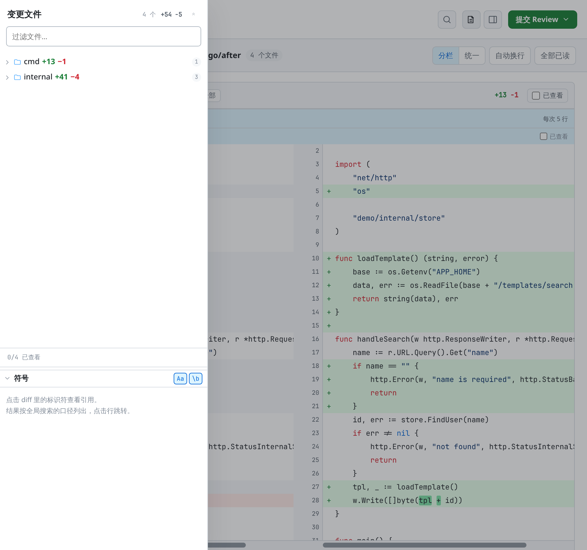

# intentflow

**本地 diff 工作台：逐文件读改动，写评论，把评论复制给 AI。**

它不像 GitHub PR 页面那样需要推送、建 PR、等 CI。打开本地仓库，直接看改动、
写评论、复制一份 Markdown 交给 Claude Code / Codex / pi 之类的编码代理。

## 它能做什么



一张图里的六个位置：

| 位置 | 用途 |
| --- | --- |
| 左上文件树 | 按目录折叠；图标表示文件类型，徽标表示增删改 |
| 左侧下半「符号」 | 点代码里的标识符，列出全仓引用，点一条就跳过去 |
| 顶栏「全部改动」 | 切换比较范围：全部改动、未提交改动、单个提交 |
| 中间 diff | 逐 hunk 展开折叠；变化只标真正改动的词 |
| `Ctrl+F` 全局搜索 | 跨全部 diff 文件搜索，结果按增 / 删 / 上下文三色 |
| 右上「提交 Review」 | 写评审意见，复制或保存为 Markdown / JSON |

下面逐条列出能力：

- 读任意 Git 范围或两个目录的文本 diff。
- 左侧文件树，按目录折叠，带文件类型图标和评论数。
- 逐 hunk 标记「已查看」；文件改过之后旧标记自动失效。
- 行级评论、跨行选区评论、不绑定文件的总评。
- 全局搜索，支持区分大小写与完整匹配。
- 点代码里的单词，列出全仓引用并跳转。
- 导出评审为 Markdown 或 JSON；`⌘↵` / `Ctrl+Enter` 直接复制 Markdown。

评审数据只存浏览器 localStorage。服务端默认不写磁盘。

## 安装

从 [Releases](https://github.com/wlingze/intentflow/releases) 下载对应平台的压缩包。

| 平台 | 文件 |
| --- | --- |
| Linux x86-64 | `intentflow_<版本>_linux_amd64.tar.gz` |
| Linux ARM64 | `intentflow_<版本>_linux_arm64.tar.gz` |
| macOS Intel | `intentflow_<版本>_darwin_amd64.tar.gz` |
| macOS Apple Silicon | `intentflow_<版本>_darwin_arm64.tar.gz` |
| Windows x86-64 | `intentflow_<版本>_windows_amd64.zip` |
| Windows ARM64 | `intentflow_<版本>_windows_arm64.zip` |

解压后得到单个可执行文件，前端已内嵌，不需要其他文件。

```bash
# Linux / macOS
tar -xzf intentflow_0.1.0_linux_amd64.tar.gz
sudo install -m755 intentflow /usr/local/bin/intentflow

# Windows（PowerShell）
Expand-Archive intentflow_0.1.0_windows_amd64.zip -DestinationPath .
.\intentflow.exe version
```

确认版本与平台：

```bash
intentflow version
# 0.1.0 (abc1234, 2026-11-13T..., go1.24.0 linux/amd64)
```

也可以从源码构建：

```bash
./scripts/build.sh
```

构建依赖 Go 1.24+、pnpm、Git；运行只依赖 Git。

## 用法

### 1. 启动

```bash
cd /path/to/your/repo
intentflow --base main
```

终端打印地址并自动打开浏览器，默认 `http://127.0.0.1:<随机端口>/`。
加 `--no-open` 只打印地址。

常用范围：

```bash
intentflow --base main                 # main → HEAD
intentflow --base main --head WORKTREE # main → 工作区，含未跟踪文件
intentflow --base v1.0 --head HEAD     # 指定提交范围
intentflow --before ./a --after ./b    # 两个目录
```

没有 `--base` 时，只接受当前 HEAD 历史里的 `main`、`master`、`origin/main`、
`origin/master`，取最近的一个。都不在历史里就要求显式指定，不会退回 `HEAD~1`。

### 2. 读改动、写评论

| 操作 | 位置 |
| --- | --- |
| 切换比较范围 | 顶栏「全部改动」下拉：全部改动 / 未提交改动 / 单个提交 |
| 加行内评论 | 代码行左侧 `+` |
| 评论多行 | 拖动选中，评论自动带引用 |
| 标记已查看 | 每个 hunk 右侧勾选 |
| 总评 | 右上「提交 Review」 |
| 全局搜索 | `Ctrl+F` / `Cmd+F` |
| 查单词引用 | 点击代码里的标识符，左侧「符号」面板列出引用 |
| 导出评审 | 右上「提交 Review」菜单 |

### 3. 交给 AI

评审意见写完，点右上角**「提交 Review」**，菜单里有 Markdown 和 JSON 两行：

- **Markdown**：`复制` 直接进剪贴板，`保存文件` 存成 `.md`。
- **JSON**：`复制` 或 `保存文件`，含完整结构，适合程序读取。

复制出的 Markdown 粘贴给编码代理即可。每条评论带文件路径、左右侧、行号，
引用的代码一并附上：

```markdown
## 评审

### 1. internal/store/store.go · R15
> query = fmt.Sprintf("SELECT id FROM users WHERE name LIKE '%%%s%%'", name)

用户输入直接拼进了 SQL。改成参数化查询：WHERE name LIKE ?，通配符放进参数。

### 2. 整体意见
这次改动把参数化查询换成字符串拼接，建议整体退回。
```

在 diff 区域按 `Ctrl+Enter` / `Cmd+Enter` 等同于菜单里的「复制 Markdown」，
不打开菜单。焦点在输入框或对话框里时不触发。

## 截图

| 评审面板 | 导出 | 窄屏 |
| --- | --- | --- |
|  |  |  |

## 参数

| 参数 | 说明 |
| --- | --- |
| `-t, --target` | Git 仓库目录，默认 `.` |
| `--base` | Git 基线，默认按祖先关系检测 |
| `--head` | Git 终点，默认 `HEAD`；`WORKTREE` 表示工作区 |
| `--before, --after` | 两个目录比较 |
| `--host` | 默认 `0.0.0.0`；仅本机可设 `127.0.0.1` |
| `--port` | 默认由系统分配空闲端口 |
| `--out` | `review.json` 导出目录 |
| `--dist` | 覆盖内嵌前端，仅调试用 |
| `--no-open` | 不自动打开浏览器 |
| `-v` | 打印进度 |

`--mode diff` 是默认且唯一模式。旧的 `scan` / `review` 模式会明确报错。

## 数据存在哪

- 评审 JSON：浏览器 localStorage，键 `intentflow.review.<comparison_id>`。
- 评论图片：内联 data URL，随评审一起存浏览器，单张上限 1.5MB。
- 布局偏好：localStorage，键前缀 `intentflow.`。
- 服务端：不写任何文件。

一个 `仓库 + 分支 + 子目录` 对应一个稳定 session，相当于本地 PR。不同仓库的
同名分支不会串记录。同一 session 下每个比较范围另存草稿，记录
`base/head/revision/diff_digest`，避免旧行号套到新代码。

## 目标与现状

三层语义 diff 和行为图是项目的目标结构，不是当前能力。

| 阶段 | 内容 | 状态 |
| --- | --- | --- |
| 一 | 文本 diff + 本地评审 | 可用 |
| 二 | SSA 事实层：项目 / 逻辑 / 意图三层 diff | 未开始 |
| 三 | 行为图：触发 → 判定 → 变换 → 效果 | 未开始 |
| 四 | LLM 叙述层：只读事实，写摘要与风险 | 未开始 |

右侧 AI 与 SyntaxFlow 两个 tab 已留位置，当前显示「未启用」。

设计取向：IR 算得出的事实（数据流、调用边、条件）可复现；算不出的意图只能
推断。两层分开放，每条结论标可信度。LLM 只读事实写摘要，不生成节点和边。
细节见 [docs/00-thesis.md](docs/00-thesis.md)。

## 开发

```bash
make tools    # 安装 oapi-codegen 与前端依赖，一次即可
make schema   # schema/openapi.yaml → Go + TypeScript 类型
make check    # go vet、Go 测试、tsc、Vitest
make build    # 前端构建 + 静态二进制
make e2e      # 真实布局下的滚动、行内标记、跳转检查
make release-check  # 六个平台交叉编译验证
```

`make e2e` 需要一个已启动的服务：

```bash
make serve                 # 用 examples/demo-go 启动
make e2e E2E_URL=http://127.0.0.1:8123
```

`schema/openapi.yaml` 是唯一数据契约，两侧类型都由它生成。

## 目录

```
cmd/intentflow/       CLI 入口
schema/openapi.yaml   唯一数据契约
internal/contract/    生成：Go JSON 类型
internal/gitcompare/  Git 比较范围与提交
internal/payload/     源码包：before/after 文本与文件状态
internal/reviewctx/   评审身份：session 与比较范围摘要
internal/serve/       HTTP 服务与内嵌前端
internal/version/     版本号、提交、构建时间
frontend/             React + TypeScript + Vite
examples/demo-go/     单文件 demo
docs/                 设计文档
```

## 文档

| 文件 | 内容 |
| --- | --- |
| [docs/00-thesis.md](docs/00-thesis.md) | 论题：代码不能表达意图 |
| [docs/02-layers.md](docs/02-layers.md) | 三层模型与身份键设计 |
| [docs/05-frontend.md](docs/05-frontend.md) | 工作台布局与交互 |
| [docs/06-behavior-research.md](docs/06-behavior-research.md) | PDG / CPG / Flows 调研 |
| [docs/07-behavior-model.md](docs/07-behavior-model.md) | 行为视图定义与 diff 规则 |
| [docs/08-contract.md](docs/08-contract.md) | OpenAPI 单一定义与生成 |
| [docs/09-review-platform.md](docs/09-review-platform.md) | 评审存储与匹配规则 |
| [docs/10-release.md](docs/10-release.md) | 版本号、发布产物与校验 |
| [docs/third-party.md](docs/third-party.md) | 第三方许可 |

## 许可

Apache License 2.0，见 [LICENSE](LICENSE)。
