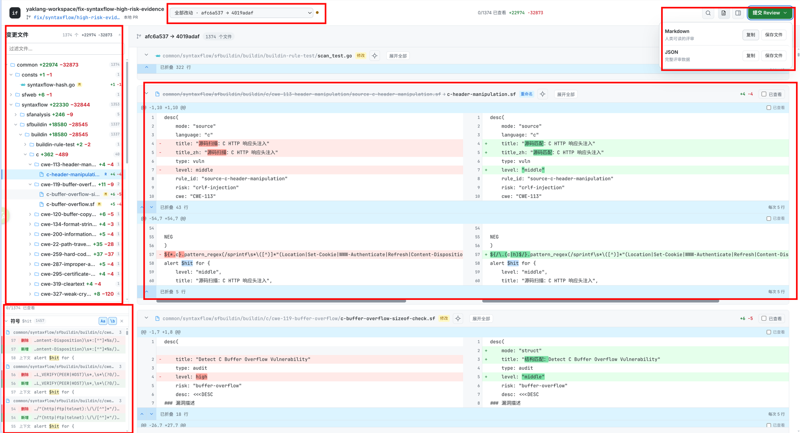
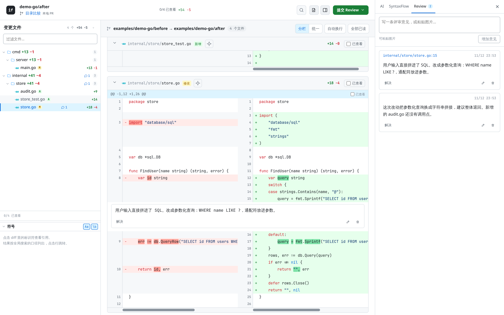
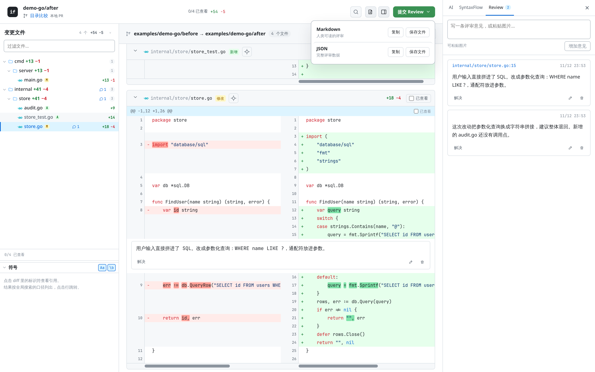
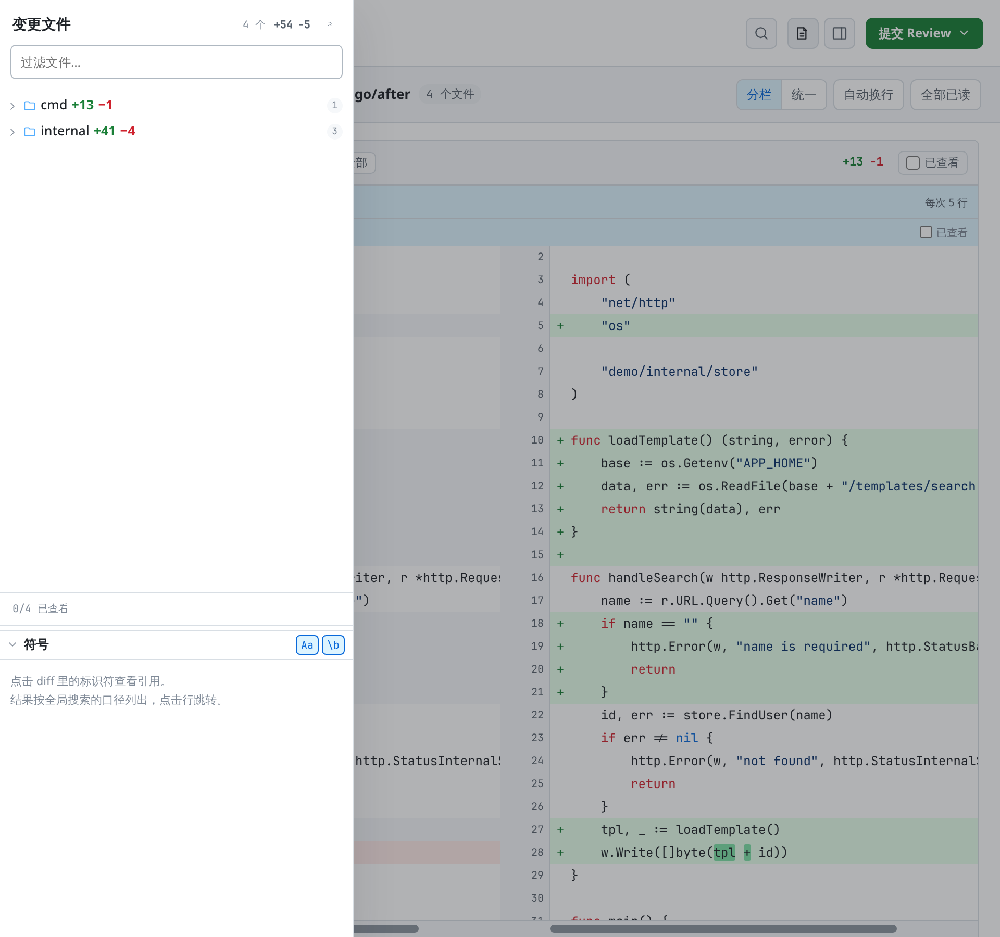

# intentflow

**本地 diff 工作台：逐文件读改动，写评论，把评论复制给 AI。**

它不像 GitHub PR 页面那样需要推送、建 PR、等 CI。打开本地仓库，直接看改动、
写评论、复制一份 Markdown 交给 Claude Code / Codex / pi 之类的编码代理。

## 它能做什么



一张图里的六个位置：

| 位置 | 用途 |
| --- | --- |
| 左上文件树 | 按目录折叠；图标表示文件类型，徽标表示增删改 |
| 左侧下半「符号」 | 点代码里的标识符，列出全仓引用，点一条就跳过去 |
| 顶栏「全部改动」 | 切换比较范围：全部改动、未提交改动、单个提交 |
| 中间 diff | 逐 hunk 展开折叠；变化只标真正改动的词 |
| `Ctrl+F` 全局搜索 | 跨全部 diff 文件搜索，结果按增 / 删 / 上下文三色 |
| 右上「提交 Review」 | 写评审意见，复制或保存为 Markdown / JSON |

下面逐条列出能力：

- 读任意 Git 范围、两个目录，或一份 patch 文件的文本 diff。
- 左侧文件树，按目录折叠，带文件类型图标和评论数。
- 逐 hunk 标记「已查看」；文件改过之后旧标记自动失效。
- 行级评论、跨行选区评论、不绑定文件的总评。
- 全局搜索，支持区分大小写与完整匹配。
- 点代码里的单词，列出全仓引用并跳转。
- 导出评审为 Markdown 或 JSON；`⌘↵` / `Ctrl+Enter` 直接复制 Markdown。
- 拉取 GitHub PR 的 diff 与已有评论，在一个只读工作台里查看。
  GitHub 提交不在 CLI 中。

评审数据只存浏览器 localStorage。服务端默认不写磁盘。

## 安装

安装脚本从[最新正式版](https://github.com/wlingze/intentflow/releases/latest)读取 `checksums.txt`，按系统与 CPU 选择压缩包。SHA-256 匹配后才解压安装，最后用安装后的绝对路径运行 `--version`。无需预先下载文件。

**macOS / Linux**（sh、bash 或 zsh）：

```sh
installer=$(curl -fsSL https://wlingze.github.io/intentflow/install.sh) &&
  sh -c "$installer"
```

默认目标是 `/usr/local/bin/intentflow`，不是 `/usr/local/intentflow`。只有写入系统目录时才需要 `sudo`。没有管理员权限时，可先设置 `export INTENTFLOW_INSTALL_DIR="$HOME/.local/bin"`，并把该目录加入 `PATH`。

**Windows**（PowerShell 5.1 或 7）：

```powershell
& ([scriptblock]::Create((curl.exe -fsSL https://wlingze.github.io/intentflow/install.ps1 | Out-String)))
```

默认目标是 `%LOCALAPPDATA%\intentflow\bin\intentflow.exe`。脚本更新当前 PowerShell 和用户 `Path`，不需要管理员权限。其他已打开的终端保留原环境；若新终端也未继承更新，注销后重新登录。

可先审阅 [sh 脚本](website/install.sh) 或 [PowerShell 脚本](website/install.ps1)。手动下载时，使用同一 release 的 `checksums.txt` 校验压缩包：

| 平台 | 文件 |
| --- | --- |
| Linux x86-64 | `intentflow_<版本>_linux_amd64.tar.gz` |
| Linux ARM64 | `intentflow_<版本>_linux_arm64.tar.gz` |
| macOS Intel | `intentflow_<版本>_darwin_amd64.tar.gz` |
| macOS Apple Silicon | `intentflow_<版本>_darwin_arm64.tar.gz` |
| Windows x86-64 | `intentflow_<版本>_windows_amd64.zip` |
| Windows ARM64 | `intentflow_<版本>_windows_arm64.zip` |

前端已内嵌。`intentflow --version` 可确认安装版本和平台。SHA-256 校验不等于 Apple 公证；如果 Gatekeeper 拒绝运行，请勿关闭系统保护。

也可以从源码构建：

```bash
./scripts/build.sh
```

构建依赖 Go 1.24+、pnpm、Git；运行只依赖 Git。

## 更新

已安装的二进制自己升级，不用重新下载解压：

```bash
intentflow update                  # 升级到最新 release
intentflow update --check          # 只看当前与最新版本，不下载
intentflow update --version v0.2.0 # 装指定版本
intentflow update --force          # 同版本也重装
intentflow update --repo me/fork   # 从 fork 的 release 升级
```

- 按 `runtime.GOOS` / `GOARCH` 选资产，只认 release.yml 产出的六个平台压缩包。
- 下载 `checksums.txt` 并校验 sha256；不匹配立即中止，磁盘不改动。
- 先写同目录临时文件、`chmod 0755`，再 `rename` 覆盖。Windows 先把旧文件改名，失败回滚。
- 完成后打印旧版本 → 新版本。
- `--check` 退出码：已是最新 `0`，有新版本 `2`，出错 `1`。
- 代理走环境变量 `HTTPS_PROXY` / `HTTP_PROXY` / `NO_PROXY`。
- 设置 `GITHUB_TOKEN`（或 `GH_TOKEN`）可避免 API 限流；token 只发给 API，不打印。

## 用法

### 1. 启动

```bash
cd /path/to/your/repo
intentflow
```

终端打印地址并自动打开浏览器，默认 `http://127.0.0.1:<随机端口>/`。
加 `--no-open` 只打印地址。

常用范围：

```bash
intentflow                              # 自动基线 → HEAD
intentflow --base main                  # main → HEAD
intentflow --base main --head WORKTREE  # main → 工作区，含未跟踪文件
intentflow --base v1.0 --head HEAD      # 指定提交范围
intentflow --before ./a --after ./b     # 两个目录
intentflow --rebase                     # 先 rebase 到基线，冲突自动回退
```

没有 `--base` 时，对 `main`、`master`、`origin/main`、`origin/master`
逐个计算 `git merge-base HEAD <ref>`，取距 HEAD 最近的一个作为基线。
当前分支不必是 main 的后代，从其他分支分出的分支也能直接启动。
如果这些 ref 都不存在，再尝试 `origin/HEAD` 和当前分支上游；
最后才报错，并提示用 `--base <ref>` 指定。

启动时打印基线、落后量和是否需要 rebase，页面顶栏同步显示。
落后只提示，不阻断启动。`--rebase` 默认关闭；显式传入才执行
`git rebase <基线 ref>`。发生冲突时立即 `git rebase --abort`，
退回 merge-base 基线继续启动。工作区有未提交改动时跳过 rebase，
不会自动 stash。

### 2. 读改动、写评论

| 操作 | 位置 |
| --- | --- |
| 切换比较范围 | 顶栏「全部改动」下拉：全部改动 / 未提交改动 / 单个提交 |
| 加行内评论 | 代码行左侧 `+` |
| 评论多行 | 拖动选中，评论自动带引用 |
| 标记已查看 | 每个 hunk 右侧勾选 |
| 总评 | 右上「提交 Review」 |
| 全局搜索 | `Ctrl+F` / `Cmd+F` |
| 查单词引用 | 点击代码里的标识符，左侧「符号」面板列出引用 |
| 导出评审 | 右上「提交 Review」菜单 |

### 3. 交给 AI

评审意见写完，点右上角**「提交 Review」**，菜单里有 Markdown 和 JSON 两行：

- **Markdown**：`复制` 直接进剪贴板，`保存文件` 存成 `.md`。
- **JSON**：`复制` 或 `保存文件`，含完整结构，适合程序读取。

仓库自带 `skills/intentflow/SKILL.md`：代理读到这份 skill 后，自己起
`intentflow --no-open --base <分支>`、等你评审完、再按粘贴或 `review.md`
的路径逐条改。不开 skill 也能用，把 Markdown 粘贴给代理即可。每条评论带文件路径、左右侧、行号，
引用的代码一并附上：

```markdown
## 评审

### 1. internal/store/store.go · R15
> query = fmt.Sprintf("SELECT id FROM users WHERE name LIKE '%%%s%%'", name)

用户输入直接拼进了 SQL。改成参数化查询：WHERE name LIKE ?，通配符放进参数。

### 2. 整体意见
这次改动把参数化查询换成字符串拼接，建议整体退回。
```

在 diff 区域按 `Ctrl+Enter` / `Cmd+Enter` 等同于菜单里的「复制 Markdown」，
不打开菜单。焦点在输入框或对话框里时不触发。

### 4. 只有一份 diff

不需要 Git 仓库，也不需要先 clone。给一个 patch 文件，直接起工作台：

```bash
intentflow diff fix.patch
```

从 stdin 读，或复制粘贴后按 `Ctrl-D`：

```bash
cat fix.patch | intentflow diff -
intentflow diff -              # 粘贴补丁，Ctrl-D 结束
intentflow diff --patch fix.patch
```

补丁解析规则、`.patch` 多提交如何合并、展开 gap 为什么是空行，见
[docs/11-static-and-pr-server.md](docs/11-static-and-pr-server.md)。

### 5. 纯静态导出

```bash
intentflow export --diff fix.patch --out site
python3 -m http.server --directory site 8000
# 打开 http://127.0.0.1:8000/
```

产物是纯静态文件：`index.html`、`assets/`、`api/payload.json`、
`api/revisions.json`。可以放进任意静态服务器、对象存储或 CDN。
必须用 HTTP 打开，`file://` 会拦截 ES module。

静态化后，看 diff、搜索、符号引用、写评论、复制 Markdown 都可用。
失效的是切换比较范围：静态包只有一份 patch，revision 列表只有 `range`。
评论仍然只存浏览器 localStorage。

### 6. 按 PR 路径浏览

```bash
intentflow serve --pr-dir /srv/intentflow/prs --host 127.0.0.1 --port 8080
# 索引页：http://127.0.0.1:8080/
# 单个 PR：http://127.0.0.1:8080/pr/wlingze/intentflow/4/
```

目录约定：

```
/srv/intentflow/prs/
  wlingze/
    intentflow/
      4.patch          # 主约定
      4.diff           # 备选；与 4.patch 同时存在时优先 .patch
      4.json           # 可选：{"title": "索引页显示的标题"}
```

本地没有补丁时默认回退抓取
`https://github.com/<owner>/<repo>/pull/<number>.diff`，公开仓库不需要 token。
抓到的补丁缓存为 `<number>.diff`。只读本地目录用 `--no-github`。
私有仓库设置 `GITHUB_TOKEN` 或 `GH_TOKEN`。

索引页、路由、静态化边界与部署示例见
[docs/11-static-and-pr-server.md](docs/11-static-and-pr-server.md)。

### 7. GitHub PR 只读

token 只从环境变量读，不落盘、不打印：

```bash
export GITHUB_TOKEN=...        # 或 GH_TOKEN
intentflow github open --repo owner/repo --pr 4
```

它拉取：

- PR 元数据：标题、base/head SHA、状态。
- 整个 PR 的聚合 diff。
- 已有行级 review 评论。

本模式只读。提交 review 不在 CLI 中；当前分支没有实现 GitHub 写回。
浏览器插件的可行方案见
[docs/11-static-and-pr-server.md](docs/11-static-and-pr-server.md)。

`github open` 与 `serve --pr-dir` 的区别：

| 模式 | 数据来源 | 范围 | 已有评论 | 认证 |
| --- | --- | --- | --- | --- |
| `github open` | GitHub REST API | 单个 PR | 导入 | `GITHUB_TOKEN` / `GH_TOKEN` |
| `serve --pr-dir` | 本地 patch；缺失时抓 `.diff` | 多 PR 路径 | 不导入 | 公开仓库可匿名 |

`serve --pr-dir` 适合部署和分享链接。`github open` 适合本地读一个 PR 及其评论。

## 截图

| 评审面板 | 导出 | 窄屏 |
| --- | --- | --- |
|  |  |  |

## 参数

| 参数 | 说明 |
| --- | --- |
| `-t, --target` | Git 仓库目录，默认 `.` |
| `--base` | Git 基线；默认取 main/master/origin/main/origin/master 的最近 merge-base |
| `--rebase` | 先 rebase 到基线；冲突自动 abort 并改用 merge-base，默认关闭 |
| `--head` | Git 终点，默认 `HEAD`；`WORKTREE` 表示工作区 |
| `--before, --after` | 两个目录比较 |
| `--host` | 默认 `0.0.0.0`；仅本机可设 `127.0.0.1` |
| `--port` | 默认由系统分配空闲端口 |
| `--out` | `review.json` 导出目录；`export` 时是静态站点目录 |
| `--diff`, `--patch` | 补丁文件；`-` 表示 stdin |
| `--pr-dir` | PR 目录，按 `/pr/<owner>/<repo>/<number>` 路由 |
| `--no-github` | 只读本地 PR 目录，不回退抓取 GitHub |
| `--force` | `export` 时允许输出目录非空 |
| `--repo` | GitHub 仓库；`export` 用来标记来源，`github` 命令用来指定仓库 |
| `--branch` | `export` 的来源分支或 PR 标签 |
| `--pr` | GitHub PR 编号 |
| `--no-comments` | 不导入已有的 GitHub review 评论 |
| `--dist` | 覆盖内嵌前端，仅调试用 |
| `--no-open` | 不自动打开浏览器 |
| `-v` | 打印进度 |

`--mode diff` 是默认且唯一模式。旧的 `scan` / `review` 模式会明确报错。

## 数据存在哪

- 评审 JSON：浏览器 localStorage，键 `intentflow.review.<comparison_id>`。
- 评论图片：内联 data URL，随评审一起存浏览器，单张上限 1.5MB。
- 布局偏好：localStorage，键前缀 `intentflow.`。
- GitHub token：只从 `GITHUB_TOKEN` / `GH_TOKEN` 读，不写文件、不打印。
- 服务端默认不写文件；`serve --pr-dir` 会把抓到的 GitHub diff 缓存到 PR 目录。
- GitHub 只读模式：PR diff 与评论只在内存；导入的评论随 payload 展示。

一个 `仓库 + 分支 + 子目录` 对应一个稳定 session，相当于本地 PR。不同仓库的
同名分支不会串记录。同一 session 下每个比较范围另存草稿，记录
`base/head/revision/diff_digest`，避免旧行号套到新代码。

## 目标与现状

三层语义 diff 和行为图是项目的目标结构，不是当前能力。

| 阶段 | 内容 | 状态 |
| --- | --- | --- |
| 一 | 文本 diff + 本地评审 | 可用 |
| 二 | SSA 事实层：项目 / 逻辑 / 意图三层 diff | 未开始 |
| 三 | 行为图：触发 → 判定 → 变换 → 效果 | 未开始 |
| 四 | LLM 叙述层：只读事实，写摘要与风险 | 未开始 |

右侧只有 Review 一个面板：评论历史加输入框。AI 与 SyntaxFlow 没有留占位页签，
需要时由外部 Agent 读取 JSON 评审。

设计取向：IR 算得出的事实（数据流、调用边、条件）可复现；算不出的意图只能
推断。两层分开放，每条结论标可信度。LLM 只读事实写摘要，不生成节点和边。
细节见 [docs/00-thesis.md](docs/00-thesis.md)。

## 开发

```bash
make tools    # 安装 oapi-codegen 与前端依赖，一次即可
make schema   # schema/openapi.yaml → Go + TypeScript 类型
make check    # go vet、Go 测试、tsc、Vitest
make build    # 前端构建 + 静态二进制
make e2e      # 真实布局下的滚动、行内标记、跳转检查
make e2e-tree # 文件树展开结构（脚本自己启动工作台）
make release-check  # 六个平台交叉编译验证
make site     # 官网本地预览，http://127.0.0.1:8131/
```

`make e2e` 需要一个已启动的服务：

```bash
make serve                 # 用 examples/demo-go 启动
make e2e E2E_URL=http://127.0.0.1:8123
```

`make e2e-tree` 用 `scripts/e2e/fixtures/tree` 的固定目录对，先 `make build` 再运行。

`schema/openapi.yaml` 是唯一数据契约，两侧类型都由它生成。

## 官网

`website/` 是项目的静态官网，无构建步骤、无包管理器、无第三方运行时请求。
部署在 <https://wlingze.github.io/intentflow/> 子路径下，所以站内链接与资源
全部用相对路径（`./assets/...`）。

```bash
make site         # python3 -m http.server --directory website --bind 0.0.0.0 8131
make site-check   # node scripts/check-site.mjs
```

用 `make site` 打开 <http://127.0.0.1:8131/>，不要用 `file://`：语言与主题的
localStorage 行为在 `file://` 下不一致。

站内中英双语共用同一份 HTML：首次访问按 `navigator.languages` 自动选择，
选择存 `intentflow.lang`，右上角按钮即时切换、不改 URL、不刷新页面。主题
默认跟随 `prefers-color-scheme`，选择存 `intentflow.theme`。中英文案只在
`website/assets/app.js` 的字典里，HTML 里写英文作无脚本兜底。

首页信息层级：一句话定位，然后是两种启动方式（人用命令行、代理用
skill），接着全幅工作台截图。之后是四个功能块：评论占整幅，复制、Git
范围、符号引用各占半幅，每块一张从真实界面裁下来的局部图，配一行说明。
文档页是左侧常驻目录加正文两栏，小于 900px 时目录收成「目录」按钮与
覆盖层，当前章节由 `IntersectionObserver` 高亮。

`make site-check` 校验必需文件、相对路径、只有 GitHub 外链、两种语言 key
集合一致、HTML 兜底文案与英文字典一致，以及首页四个重点块、文档侧边栏
锚点与正文 `id` 双向一致、滚动高亮脚本存在。改官网时先跑它。

`.github/workflows/pages.yml` 在 `master` 上 `website/**` 变更后发布，
上传前同样跑一遍校验。编辑规则见 [website/README.md](website/README.md)。

## 目录

```
cmd/intentflow/       CLI 入口
schema/openapi.yaml   唯一数据契约
internal/contract/    生成：Go JSON 类型
internal/gitcompare/  Git 比较范围与提交
internal/patch/       unified diff 解析与多提交合并
internal/payload/     源码包：before/after 文本与文件状态
internal/prdiff/      补丁 → payload / revision 列表
internal/ghreview/    GitHub REST：PR、diff、评论、review 提交
internal/export/      纯静态站点导出
internal/reviewctx/   评审身份：session 与比较范围摘要
internal/serve/       HTTP 服务与内嵌前端
internal/version/     版本号、提交、构建时间
frontend/             React + TypeScript + Vite
examples/demo-go/     单文件 demo
docs/                 设计文档
skills/intentflow/    给代理用的 skill
website/              静态官网（GitHub Pages）
```

## 文档

| 文件 | 内容 |
| --- | --- |
| [docs/00-thesis.md](docs/00-thesis.md) | 论题：代码不能表达意图 |
| [docs/02-layers.md](docs/02-layers.md) | 三层模型与身份键设计 |
| [docs/05-frontend.md](docs/05-frontend.md) | 工作台布局与交互 |
| [docs/06-behavior-research.md](docs/06-behavior-research.md) | PDG / CPG / Flows 调研 |
| [docs/07-behavior-model.md](docs/07-behavior-model.md) | 行为视图定义与 diff 规则 |
| [docs/08-contract.md](docs/08-contract.md) | OpenAPI 单一定义与生成 |
| [docs/09-review-platform.md](docs/09-review-platform.md) | 评审存储与匹配规则 |
| [docs/10-release.md](docs/10-release.md) | 版本号、发布产物与校验 |
| [docs/11-static-and-pr-server.md](docs/11-static-and-pr-server.md) | 单 diff、静态导出、PR 路由与 GitHub 兼容 |
| [docs/third-party.md](docs/third-party.md) | 第三方许可 |

## 许可

Apache License 2.0，见 [LICENSE](LICENSE)。
